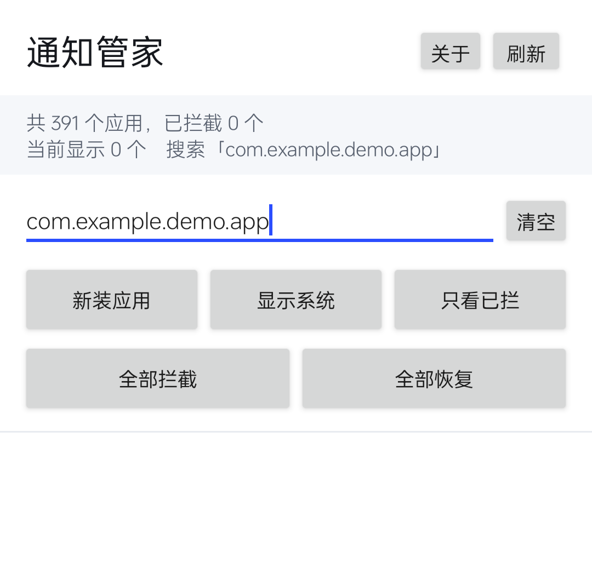
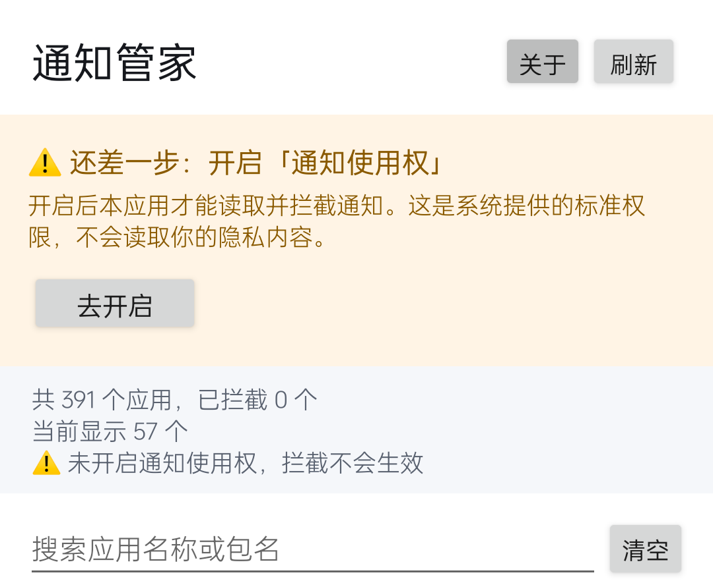
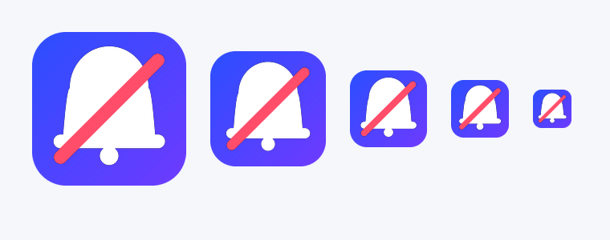

# 通知管家 (Notification Butler)

**无需 root，拦截任意应用的通知。**

一个轻量的 Android 通知管理工具。基于系统的「通知使用权」实现，
不使用 root、不修改系统、不申请联网权限。

> A lightweight, **root-free** Android notification blocker built on
> `NotificationListenerService`. No root, no system modification, no
> network permission.

---

## 截图

| 主界面 | 服务断开提醒 | 图标 |
| --- | --- | --- |
|  |  |  |

---

## 功能

- **列出所有应用** —— 图标、名称、包名，可切换显示/隐藏系统应用
- **搜索** —— 同时匹配应用名称和包名
- **一键拦截 / 恢复** —— 只作用于**当前筛选出的列表**，可配合搜索批量操作
- **撤销** —— 批量操作后可以一键还原，不怕误触
- **新装应用自动识别** —— 装完新 App 自动标记并排到最前
- **只看已拦截** —— 快速回顾和管理拦截名单
- **服务状态检测** —— 监听服务意外断开时明确提醒，不会静默失效
- **后台运行引导** —— 针对国产 ROM 的后台冻结问题给出提示

---

## 它是怎么工作的

### 为什么不 root 也能拦截通知

Android 并不允许普通应用修改别的应用的通知开关 —— 那是系统级权限。
但有一条**官方且标准**的路径：

```
用户授予「通知使用权」
        ↓
系统把所有应用的通知都投递给本应用
   (NotificationListenerService.onNotificationPosted)
        ↓
本应用在通知【显示出来之前】调用 cancelNotification() 把它取消掉
        ↓
用户看不到这条通知 —— 效果等同于「禁止通知」
```

这正是**通知滤盒**、**BuzzKill** 这类应用的做法。

### 与 root 方案的区别

| | root 方案 | 本方案 |
| --- | --- | --- |
| 原理 | 直接改系统设置（`appops`） | 实时拦截并取消 |
| 效果 | 应用永久不能发通知 | 应用照发，但用户看不到 |
| 需要权限 | root | 通知使用权 |
| 是否可逆 | 改系统状态 | 只在本机内存中判断 |

### 那个「实时」有多快

`cancelNotification()` 是异步的，理论上通知可能闪现一帧。
实测在 Android 14 / ColorOS 上肉眼不可见，但这是该方案的固有限制。

---

## 安装

从 [Releases](../../releases) 下载 APK 安装，或自行构建（见下）。

首次启动需要授予**通知使用权**：

```
打开应用 → 点顶部提示条的「去开启」
        → 在系统列表里找到「通知管家」并打开开关
        → 返回
```

> **国产 ROM 用户注意**：ColorOS / MIUI / EMUI 等系统会冻结后台进程，
> 导致监听服务收不到通知。请在应用内点「去设置」把本应用加入
> **电池优化白名单**（或设为「允许后台运行」）。

---

## 从源码构建

本项目**不使用 Gradle**，也不需要 Android Studio。
只用 SDK 自带的命令行工具手工构建。

### 你需要

- **JDK 8+**（提供 `javac` 和 `keytool`）
- **Android SDK** 的这两部分：

```bash
sdkmanager "build-tools;34.0.0" "platforms;android-34"
```

### 构建

```bash
git clone <你的仓库地址>
cd notification-butler

# 方式一：环境变量
export ANDROID_SDK_ROOT=/path/to/android-sdk
python3 scripts/build_apk.py

# 方式二：命令行指定
python3 scripts/build_apk.py --sdk /path/to/android-sdk

# 方式三：在根目录建 local.properties
echo 'sdk.dir=/path/to/android-sdk' > local.properties
python3 scripts/build_apk.py
```

产物在 `build/NotifButler.apk`。

### 重新生成图标

```bash
pip install pillow
python3 scripts/make_icon.py
```

### 构建流程

脚本做的事（可以照着手动执行）：

```
aapt2 compile  →  编译 res/ 为扁平资源
aapt2 link     →  生成 APK 骨架 + R.java
javac          →  编译 Java 源码
d8             →  转成 classes.dex
zip            →  把 dex 打进 APK
zipalign       →  4 字节对齐
apksigner      →  签名
```

---

## 项目结构

```
app/
  AndroidManifest.xml
  src/com/dsh/notifbutler/
    MainActivity.java       界面：列表、搜索、筛选、批量操作
    NotifListener.java      ★ 通知监听服务（核心）
    NotifAccess.java        权限检查与申请
    PackageReceiver.java    新装应用识别
    BootReceiver.java       开机处理
    Prefs.java              本地存储（带内存缓存）
    AppEntry.java           列表数据
    AppListAdapter.java     列表适配器
  res/
    layout/                 布局
    drawable/               自适应图标背景
    mipmap-*/               图标各密度
    values/                 主题与颜色
scripts/
  build_apk.py              手工构建脚本
  make_icon.py              图标生成脚本
```

---

## 已知限制

这些不是 bug，是方案本身的边界：

| 限制 | 原因 |
| --- | --- |
| 拦截有极短延迟 | `cancelNotification()` 是异步的 |
| 前台服务通知不拦 | 取消它会导致对方的服务被杀 |
| 系统级通知拦不了 | 如 USB 调试、系统更新，无权限 |
| 服务断开后会失效 | 系统回收 / 被 ROM 冻结；应用会检测并提醒 |
| 不追溯历史通知 | 服务连接之前的通知不会被清 |

---

## 常见问题

**Q：为什么需要「通知使用权」这么敏感的权限？**
A：这是 Android 提供的唯一一条无需 root 就能读取通知的官方途径。
本应用不联网，通知内容只在本机内存中比对后立即丢弃，不存储、不上传。
可以在「关于」页看到完整的隐私说明。

**Q：为什么拦截了还能看到通知一闪？**
A：见上文「那个实时有多快」。属于 `NotificationListenerService` 方案的固有限制。

**Q：为什么过一段时间就失效了？**
A：大概率是系统把后台进程冻结了。打开应用看看顶部有没有橙色警告条，
按提示加入电池优化白名单。

**Q：可以拦截系统应用吗？**
A：可以，但注意「显示系统应用」默认是关的。请谨慎操作 —— 拦截来电、
短信、闹钟的通知可能不是你想要的。

---

## 权限说明

| 权限 | 用途 |
| --- | --- |
| `QUERY_ALL_PACKAGES` | 列出所有已安装应用，供你选择 |
| `BIND_NOTIFICATION_LISTENER_SERVICE` | 读取并拦截通知（核心功能） |
| `RECEIVE_BOOT_COMPLETED` | 开机后恢复监听 |
| `REQUEST_IGNORE_BATTERY_OPTIMIZATIONS` | 申请加入电池白名单，避免被冻结 |

**没有**申请 `INTERNET` —— 应用完全离线。

---

## 贡献

欢迎提 Issue 和 PR。特别欢迎：

- 各品牌 ROM 的适配经验（尤其是后台冻结的处理）
- 新的筛选/规则功能
- 翻译

---

## 许可

[MIT](LICENSE)
